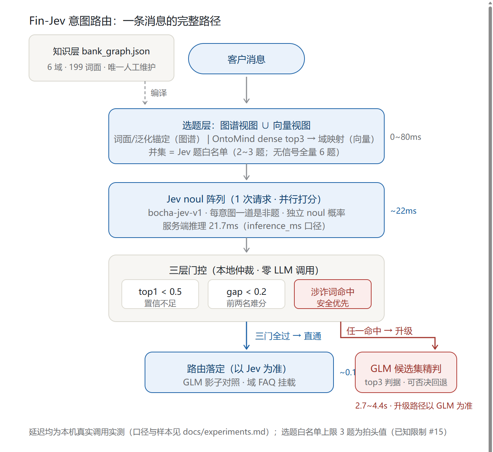
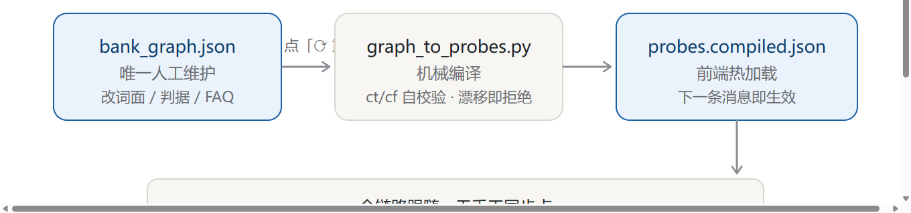

# Fin-Jev 双引擎意图识别架构

> 状态：v2.1（2026-09-28 · bank6 + R47 向量选题）· 适用范围：手机银行客服消息路由 PoC（六域：转账/理财/账户/挂失止付/投诉/生活缴费）
> 配套：`README.md`（怎么跑）、`docs/experiments.md`（实验数据唯一权威）、`wealth_graph/func_test.py`（怎么测）

**按目标阅读**：

| 你想搞清楚 | 去哪节 |
| --- | --- |
| 整个系统怎么协作（一图流） | §1 总览 |
| 知识长什么样、放哪里 | §2 知识层 |
| "给哪几道题"怎么选出来 | §3 召回机制 / §5.5 / §5.5b |
| 门控阈值凭什么定 0.5/0.2 | §4.2 + experiments.md §E3 |
| 为什么不省掉某个组件 | §7 设计取舍（每条带代价） |
| 哪些地方还没做好 | §9 已知限制（15 条诚实清单） |

---

## 0. 一句话定位

用**一份人工维护的意图图谱**同时驱动两个引擎——Jev 是非题阵列（20ms 粗判）与 GLM-Flash（2.7~5.1s 精判）——中间用概率 gap 门控决定谁说了算，目标是：直通流量拿到检索式系统无可比拟的低延迟，模糊流量不硬判、交给大模型兜底。

**名词表**（后文直接使用）：

| 名词 | 是什么 |
| --- | --- |
| Jev | TypeSafe AI（旧金山，前 OpenAI 研究员 Diogo Almeida 创立）2026-09 发布的首个 **System One 模型**：不生成文本，输入状态 + 类型化问题（Choice/Score/Noul 三类），直接返回带校准概率的结构化决策（官方口径见 [TypeSafe 发布博客](https://typesafe.ai/blog/introducing-system-one-models-and-jev)：端到端 70~500ms）。名字取自杰文斯（Jevons）。原版 API 未对中国大陆开放，本项目用博查的中国版 bocha-jev-v1（open.bocha.cn）：一次请求并行输出每题 0~1 连续概率，服务端推理毫秒级 |
| noul | Jev 三类问题之一（Choice 候选选择 / Score 等级评分，本项目未用）：布尔命题判定，每题独立返回连续概率而非硬标签，是门控分诊的原料 |
| GLM | 智谱生成式大模型（glm-5.3-flash），模糊流量的语义精判器 |
| 选题 | 运行期决定"这次请求给 Jev 出哪几道是非题"（图谱锚定 ∪ 向量映射，无信号全量 6 题） |
| 门控 | 本地仲裁规则：top1<0.5 / 前两名 gap<0.2 / 涉诈词命中，任一命中即升级 GLM |

本方案回答三个此前未成文的问题：知识给什么（§2）、召回怎么发生（§3）、两引擎如何协作（§4~§5）。

---

## 1. 总览



图上每段延迟均为本机真实调用实测（口径见 §6 与 experiments.md）。阅读顺序沿主轴自上而下：选题层决定"出哪几道题"，Jev 阵列一次请求并行打分，三层门控分诊——全过则直通 argmax（~0.1s 总延迟），任一命中则升级 GLM 候选集精判（2.7~4.4s）。知识层（左上）是唯一人工维护点，经编译器向下供两引擎消费。

**职责分工**：Jev = 召回器 + 粗判器（全量扫描、毫秒级、无候选集漏失）；GLM = 精判器（语义复核、秒级、单次生成）。门控是两者的路由器，不是事后补丁。

**消费形态差异**（同一份知识的两种投影）：Jev 拿到的是"每场景一道是非题"（scene 级粒度），GLM 拿到的是"每类一段紧凑判据"（leaf 级粒度）。

---

## 2. 知识层：图谱 schema 与资产清单

### 2.1 层级结构

```
root → domain(6：transfer/wealth/account/loss_fraud/complaint/utility)
         → leaf(6，每域 1) → scene(7，DO/QUERY/HELP 按需组合)
```

每个 scene 携带六类字段，缺一不可：

| 字段 | 作用 | 反面教材（R40 实证） |
|---|---|---|
| `retrieval_profile.aliases`（≥8 条） | 词面召回素材 + 编译进 true 判据 | 少于 8 条时泛化误触发 |
| `retrieval_profile.negativeExamples` | 编译进 false 判据；兄弟场景互配 | 缺失 → complaint 泛化匹配"推荐理财吧" |
| `retrieval_profile.threeViews` | object/action/userGoal 三视图 | — |
| `semantic_definition` | 场景定义（进题干 question） | — |
| `task/knowledge_binding` | 执行期挂载 FAQ/能力 | — |
| `execution_binding` | 裁决期动作 | — |

**编译纪律**：人是图谱的唯一写入方；是非题、加成表、GLM 判据、FAQ、混淆对全部机械编译，禁止手改编译产物。违反的代价见 §9 已知限制 #2（R40 踩坑，R44 已接编译链修复）。

### 2.2 当前资产实测（bank6）

| 资产 | 数量 | 消费者 |
|---|---|---|
| domain | 6（transfer/wealth/account/loss_fraud/complaint/utility） | Jev 题白名单、GLM 判据、图谱树 |
| leaf | 6（每域 1：demo.<域>.<动作>） | Jev 题、GLM 判据 |
| scene | 7（DO/QUERY/HELP 按需组合） | Jev 题 |
| graphIndex 词面 | 199（20 节点合计） | 运行期词面锚定 |
| relations（confusable_with） | 4（utility↔account、complaint↔wealth 等） | 扩展命中 + GLM 混淆提示 |
| capabilities | 5 | 执行期挂载 |
| faqs | 9（transfer/wealth/utility 各 2，account/loss_fraud/complaint 各 1） | 执行期命中注入 |
| policies | 1 | 裁决期规则 |

---

## 3. 召回机制：图谱双视图 + 向量语义视图，共同服务一个判别目标

当前召回分三路。前两路是**同一份图谱的两个视图**（词面/结构视图 + 编译期判据视图），第三路是向量库的**语义视图**——三个视图消费同一业务知识，共同产生"给 Jev 出哪些题"的选题信号与门控证据：

| 通道 | 时机 | 策略 | 喂给谁 |
|---|---|---|---|
| **编译期定型**（判据视图） | 离线一次 + 一键重编译 | 图谱编译成是非题阵列；运行期按选题白名单裁剪（无信号时全量） | Jev 打分 + 门控阈值 + 涉诈词扫描 → 路由骨架 |
| **运行期图遍历**（R46d，词面/结构视图） | 每条消息 | 词面锚定（+R47 泛化锚定）→ 上溯域聚合 → 沿混淆边扩展 → 挂载域 FAQ（见 §5.5） | 选题信号（域得分排序）+ 流水线证据展示 + FAQ 挂载 |
| **运行期向量检索**（R46/R47，语义视图） | 每条消息 | OntoMind dense 检索 238 条意图语料 top3 → `vecToDomains` 映射出候选域 | **选题信号（R47，与图谱锚定取并集）**+ 门控升级时 GLM 候选集的语义邻居证据 |

**三视图不可互替**：判据视图输出校准过的概率（dense 分数无法校准 gap 规则）；图遍历消费图谱**结构**（层级/边/资源挂载），给可见证据链；向量视图补词面覆盖不到的语义表达（"帮我把这个月费用交一下"无任何图谱词面命中，向量救活 → [utility]）。三者**融合点在选题**：图谱锚定域 ∪ 向量映射域 = Jev 题白名单（上限 3，保底 2——单题 gap=1 必直通会废掉门控）。

**Jev 判据的两阶段**：
1. 编译期（离线一次 / 页面一键重编译）：`graph_to_probes.py` 把 6 域图谱编译成 6 道是非题（true=aliases+三视图，false=negativeExamples），落盘 `probes.compiled.json`。知识的"召回定型"发生在这一步。
2. 运行期（每条消息）：选题白名单（图谱锚定 ∪ 向量映射，无信号则全量 6 题）+ `state.message` 打包为 1 次请求，服务端并行打分，每题独立返回 noul 概率。

**GLM 召回现状**：直通影子对照全量注入 6 类判据（同源 ct）；门控升级走候选集精判（top3 判据+混淆对提示+候选域 FAQ+向量召回片段+图谱遍历证据）。

---

## 4. Jev 侧子系统

### 4.1 编译器演进（wealth_graph/graph_to_jev.py v1→v4，理财单域时期）

> 该编译器是六域 bank_graph/graph_to_probes 链路的前身，v1→v4 的机制演进沉淀在 `wealth_graph/` 历史资产中，此处保留决策脉络：

| 版本 | 机制 | 解决的问题 | 代价 |
|---|---|---|---|
| v1 | 绝对 gap 阈值 0.2 | — | 失效：兄弟场景本底 0.6~0.7 |
| v2 | 相对差 (p1−p2)/p1<0.5 + 词面加成表 + 对象域复核 | 加分只影响是否入选，不影响判分 | 加成表需人工维护 |
| v3 | QUERY/ASK 证据词（基准/持仓/成交/可以买） | "能买吗"类问句误判 DO | 词表膨胀风险 |
| v4 | 复合意图：品牌词折算对象域 + 每域按 raw 概率保送 top2 + 候选集容量 5 | "稳享到期转定投"跨域漏召回 | 铁律：**加成后的分不得用于域内排序**，只用于准入 |

### 4.2 仲裁器与门控（本地代码，零 LLM 调用）

```
输入：选题后白名单题（2~3 题或全量 6 题）概率 + 原始消息文本
处理：涉诈词扫描（FRAUD_WORDS 10 词）→ 域聚合 → top1/gap 计算
输出路由（三规则，任一命中即升级）：
  ① top1 < 0.5        → 置信不足
  ② gap = p1−p2 < 0.2 → 模糊带
  ③ 命中涉诈词        → 强制升级（安全优先于延迟）
```

**考核指标是"错误直通数"（top1 错且 gap≥0.2，即 GLM 兜不住的错误），不是裸 top1 正确率。** R40 实测：V6 方案下 26 条样本错误直通数 = 0——所有 top1 漂移样本 gap 均 <0.2，全部落入升级通道被 GLM 正确兜底。

---

## 5. GLM 侧子系统

- **调用形态**：`glm-5.3-flash`，temperature 0.1，单次调用直接输出 `{probs, top, reason}` JSON。
- **双模式请求**（R45 起）：
  - **全量模式**（直通影子对照 / Jev 失败降级）：sysPrompt 注入全部 6 类判据，现行方式。
  - **候选集精判模式**（门控升级路径）：sysPrompt 只注入 top3 判据（带 `[Jev 概率 xx%]` 标注）+ 图谱 `confusable_with` 混淆对提示 + 候选域 FAQ，并授予否决权——GLM 可输出 `top:"none"` 表示候选集外，前端自动回退全量重判（重判结果标记 veto 展示）。O(N)→O(k)，是 §8 规模路线 200+ 类形态的第一级落地。
- **同源纪律**：两种模式的类别定义**均引用编译产物的 ct 字段**——修判据一处改、两引擎同时生效（R40 投诉修复已实证：改 ct 后 GLM 自动继承）。
- **参数知识与注入知识的分工**：GLM 权重自带语言理解（什么是"态度差"、什么是请求语气），但银行域判据不在权重里，必须每次注入。升级复核时 GLM 看到 Jev 的 top 分布，职责是"在 Jev 拿不准的模糊带里做语义精判"，不是重新全量分类。
- **执行期知识挂载**：路由域落定后（直通即挂 / 升级终判后挂），从编译产物 `faqs`（带 domain 归属）过滤命中域 FAQ 展示——知识从"判断用"延伸到"答复用"，同一份图谱两种消费。
- **降级链**：智谱直连 ← 本地 8787 转发（内置 Key）← 本地关键词基线（演示模式）。GLM 失败不影响 Jev 已出的直通路由。

### 5.5 图谱遍历召回（R46d，运行期）

此前"图谱召回"名不副实——图谱结构只在编译期被消费，运行期没有任何遍历动作。R46d 起每条消息真实走四步遍历（`duel_chat.html:graphRecall`，零 LLM 调用）：

```
① 词面锚定  消息 text 与 graphIndex 节点 terms（scope_in/navigationTerms/aliases/recallTerms）
            精确包含匹配（t.length>=2），命中节点带词面证据
①b 泛化锚定（R47 补盲区）单动词+金额的中文高频表达（"我要转300元"）因 t.length>=2
            过滤天然漏掉——结构正则补锚：/[转汇]\s*[0-9一二三四五六七八九十百千]|转\s*(个|一笔|一下)/
            → transfer；(交|缴|充)... 同构 → utility。误报边界实测：「地址会转到…」「转 Proof of…」不命中
② 上溯聚合  命中 scene/leaf 沿 parent 链上溯至 domain（≤4 跳），域得分 = 命中词数之和
            （泛化锚定得分并入）
③ 沿边扩展  top1 域查 relations 的 confusable_with 边，相邻域进"扩展命中"（低权重）
④ 资源挂载  top1 域从 faqs（按 domain 归组）挂载 FAQ → FAQ 卡片
```

- **数据源**：编译产物新增 `graphIndex`（`graph_to_probes.py` 生成）——20 节点查询索引（1 root + 6 domain + 6 leaf + 7 scene），每节点 `{type, title, parent, terms}`，共 199 词面。图谱改词面/边/FAQ 后重编译即跟随（同源纪律）。
- **证据链**：全程步骤记录在 `GRECALL_TRACE`，流水线"知识召回·图谱"阶段展示四段：锚定节点+命中词、域得分条、扩展域、挂载 FAQ。遍历耗时毫秒级（实测 0~1ms）。
- **失败模式**：纯语义无词面消息（"这钱怎么莫名其妙少了"）锚定为空——词面锚定让位于 Jev 判据打分与向量选题，不是缺陷而是分工。
- **代价**：精确包含匹配对中文分词不鲁棒（"手机号转账"不会匹配"手机号"——本例是防误命中的巧合受益，反向场景"转账"匹配"手机转账"类词面需图谱作者维护 terms 质量）；O(节点数×词面数) 线性扫描，20 节点无感，200+ 域时需倒排。

### 5.5b 向量选题（R47）：语义视图进 Jev 选题

向量库与图谱是**同一业务知识的两个视图**：向量命中语义相似的意图片段，片段 source 机械映射到图谱域 key（`VEC_DOMAIN_MAP`，6 组关键词规则），映射结果与图谱锚定取**并集**作为 Jev 选题白名单。时序上 Jev 请求推迟到向量召回返回后发出（先向量后 Jev；向量失败/超时降级纯图谱选题，不影响路由）。实测代价与收益：

| 项 | 数据 | 口径 |
|---|---|---|
| 时序代价 | Jev 发出延迟 +40~80ms（向量 RTT） | OntoMind dense 检索本机 |
| 收益案例① | "我要转300元"：词面锚定 0 命中（单字过滤盲区）→ 泛化锚定 + 向量双通道 → [transfer] 选题 | 2026-09-28 实测 |
| 收益案例② | "帮我把这个月费用交一下"：图谱词面 0 命中 → **仅向量救活** → [utility] | 同上 |
| 映射可靠性 | score≥0.6 过滤；639ms 内返回正确映射 | 向量端到端含网络 |

**已知边界**：`VEC_DOMAIN_MAP` 是前端硬编码的关键词映射——理想形态是向量库 metadata 直接携带 domain 字段（入库时标注），映射层即可删除；在 metadata 改造前，新增业务域必须同步维护这张表。

### 5.6 知识闭环：改图谱 → 一键重编译 → 前端热加载（R46 收尾）



改 `bank_graph.json` 存盘后，无需手动跑脚本、无需重启服务：
1. 流水线"知识召回·图谱"阶段点 **⟳ 重新编译图谱** 按钮 → `POST /v1/recompile`；
2. `jev_proxy.py` 子进程运行 `graph_to_probes.py`（含 ct/cf 自校验——基准漂移时 exit 1，编译产物不被污染，页面报编译失败）；
3. 编译成功后前端自动 `loadCompiled()` 热加载——判据（Jev 题/门控/GLM prompt 源）、图谱树、混淆对、FAQ、图遍历索引 graphIndex 全量刷新，下一条消息即用新知识。

活体实验（2026-09-28）：transfer 域加词面"异地汇款"→ 编译前线上 graphIndex 无该词 → 一键重编译 ok → 线上 terms 跟随 → `graphRecall("我从外地汇款过去怎么收费")` 锚定 3 节点、transfer 3 词 top1；回滚词面重编译后还原。全链路无手工同步点。

---

## 6. 实测数据（全部为自测，口径随附）

| 实验 | 样本 | 结果 | 口径 |
|---|---|---|---|
| R37 知识形态对比 | 23 条验证集 | JEV 阵列 **100%** / 均延迟 184ms；G1 目录式 91%/4553ms；G2 别名增强 96%/4028ms；G3 全量 criteria 同源 96%/4619ms | 单机直连 bocha-jev-v1 与智谱 coding 端点，2026-09-27 |
| R38 功能测试 | 49 用例（覆盖28/功能内4/跨功能4含复合2/域外8/对抗5） | JEV **49/49**，GLM-G2 47/49 | 判定=直通命中或升级∈top3；复合=两域均∈top3；三轮迭代后 |
| R40 criteria 对照 | 26 条（11 新覆盖+15 原版回归） | V0 原版 12/26（推荐类全误判）；**V6 手术版 16/26 且错误直通数 0**；V7 加词版 15/26（弃用） | top1 正确数；错误直通数=top1 错且 gap≥0.2 |
| R40 修复复测 | "推荐理财吧" 线上链路 | wealth 0.66 top1（修复前 complaint 0.83）；complaint 0.83→0.32 | 走 8787 同源转发，2026-09-28 |
| R45 候选集精判 | "推荐理财吧"（升级路径真实调用） | top=wealth 0.92，complaint 0.05；prompt 838 字符 vs 全量 1100+；reason 主动引用混淆对口径 | 智谱 coding 端点直连，temperature 0.1，2026-09-28 |
| R45 否决权 | 候选集外消息（挂失诉求，仅给 wealth/complaint 候选） | GLM 正确输出 top="none"（"客户真实诉求是银行卡挂失，与理财购买和投诉纠纷均不相符"）→ 前端回退全量重判 | 同上 |
| R46d 图遍历召回 | r46d_lab.js 17 断言（6 场景：投诉/转账/查余额/词面边界/纯语义/证据链） | 17/17 通过；"你们什么态度我要投诉"锚定 3 节点→complaint 6 词 top1→扩展 wealth→挂 FAQ；"帮我给张三转五千块"命中 scene 长词面"给张三转五千"→扩展 loss_fraud | Node 沙箱注入真实 graphIndex（probes.compiled.json）重放 graphRecall，2026-09-28 |
| R46 一键重编译活体实验 | transfer 域加词面"异地汇款"→编译→验证→回滚 | 编译前线上无该词→recompile ok→线上 terms 跟随→"我从外地汇款过去怎么收费"锚定 3 节点 transfer top1→回滚还原 | 8787 线上端到端（POST /v1/recompile + fetch 编译产物 + graphRecall 重放），2026-09-28 |
| R46e 选题模式门控对照 | "你们什么态度我要投诉"全量 5 题 vs 选题 2 题（complaint+wealth）真实调用 | 全量：complaint 0.5943/loss_fraud 0.5705 gap 0.0238 → 升级；选题：complaint 0.6066/wealth 0.4394 gap 0.1672 → 升级（结论一致，但 complaint 分数漂移 +0.012，gap 分布移动证实 #11 所述风险） | 直连 bocha-jev-v1（同判据文本），单次调用，2026-09-28 |
| bank6 utility 域扩容 | 图谱 5 域→6 域，全链路（编译→8787 下发→回归→端到端） | r45_lab 36 断言 + r46d_lab 17 断言全过；"我要交水费" utility 0.729 top1（扩容前图谱无缴费类知识，向量命中图谱外正确答案但无题可选）；6 题 input_tokens 919（5 题 742，线性合理） | 8787 线上端到端真实调用，2026-09-28 |
| 泛化锚定补盲区 | "我要转300元"等 8 条"单动词+金额"同构消息 | 修复前词面锚定全 0 命中（t.length>=2 过滤）；修复后 transfer=1 结构锚定 + 向量 [transfer] 双信号；误报边界：「地址会转到」「转 Proof of work」不命中 | 前端 graphRecall 单元级实测，2026-09-28 |
| R47 向量选题 | "帮我把这个月费用交一下"（图谱词面 0 命中） | 向量单独救活：top1 命中 life.water 类语料 → vecToDomains → [utility] → 选题 2 题（utility+相邻域） | 8787 端到端，向量→映射→选题全链路，2026-09-28 |

样本量为 PoC 级（23~49 条），任何百分比不外推为生产指标；上线前需 ≥200 条真实标注复核（置信度分桶校验脚本已备：`jev_finance_poc.py:calibration_report`）。

---

## 7. 设计取舍（独立成文）

### Why not 纯 GLM 单引擎
延迟 2.7~5.1s vs Jev 20ms——直通流量慢 100 倍以上；且 R37 证明单次生成封顶 96%（无候选集容错），JEV 阵列同源知识 100%。
**代价**：双引擎 = 双倍运维面 + 门控阈值需要持续校准（0.2 这个数来自 49 用例网格扫描，换域要重扫）。

### Why not 向量检索做校准判分（但向量检索做选题是另一回事）

判分环节（输出概率）坚持 Jev 判据阵列、不换 dense 检索分数：dense 相似度未校准，无法支撑 gap<0.2 这类门控规则；且检索引入漏召回失败模式（top-k 外即全错），判据全量/白名单激活天然免疫。检索的 O(logN) 优势在 N=6 时无意义。
**代价**：判据阵列的请求体积随域数线性增长（§8 规模路线处理）。
**但注意（R47 修正）**：向量检索不进判分、**进选题**——它的语义召回正好补图谱词面的盲区，两者是互补不是互斥。"向量 or 图谱"是假问题，"向量选什么题 + 图谱怎么打分"才是真结构（§3、§5.5b）。

### Why not GLM 复核也全量（规模拐点后）
6 类时全量注入仅 200 字，正确。200+ 类时 O(N) 爆炸且噪声稀释判据。
**解法**：Jev 降格专职召回器（top-k 候选），GLM sysPrompt 只拼候选集判据 O(k)，并给 GLM"候选集外否决权"（top="none" 时回退全量重判，召回漏失有逃生门）。
**代价**：引入候选集错误传播风险——Jev 召回漏了，GLM 永远看不到正确答案，否决权只能把"错误精判"变成"回退重判"，救不回召回本身的漏失（R38 复合意图 case 的教训）。
**当前状态（R45 已实现）**：6 类下直通路径仍走全量影子对照（收益为零的路径不加复杂度）；门控升级路径走候选集精判——GLM 只看 top3 判据 + Jev 概率标注 + 图谱混淆对提示 + 候选域 FAQ + 向量召回片段 + 图谱遍历证据。实测："推荐理财吧"候选集精判 prompt 838 字符（全量约 1100+），top=wealth 0.92 且 reason 主动引用混淆对口径；否决权实测：候选集外消息（挂失诉求只给 wealth/complaint 候选）正确输出 top="none" 回退全量。

### Why 是非题而非多分类
noul 每题独立输出概率：①天然支持多标签（复合意图 = 两域同时高）；②单题歧义可被其他题的分数对比暴露（仲裁依据）；③增删场景 = 增删题，不动其他题。
**代价**：6 题互相关判据靠 negativeExamples 人工互配；题间无协商机制，冲突全部丢给仲裁器。

### Why 图谱是唯一事实源
R40 实证了反面：duel_chat 的 PROBES 手工镜像导致图谱侧与前端侧判据漂移（图谱里 complaint 仍是旧版）。同一知识两处维护必然漂移——**解法是把 PROBES 接上编译链**（graph_to_probes），HTML 只读编译产物。R44 已落地：页面 fetch `probes.compiled.json` 覆盖内嵌兜底值，图谱改判据/FAQ/混淆对，前端自动跟随。

---

## 8. 规模演进路线

| 意图规模 | 架构 | 变更点 |
|---|---|---|
| ≤50 类（现状） | 双引擎全量 | 不变 |
| 50~200 类 | 分域两级 | 域门先粗召回 → 域内精判（graph_to_jev v4 的域保送 top2 已是第一级实现） |
| 200+ 类 | 两级流水线 | Jev=召回+粗判出 top-k → GLM 精判候选集 + 否决权（R45 已在 6 类的升级路径上预演此形态：候选集精判 O(k) + top:"none" 否决回退，实测通过） |

图谱 root→domain→category→leaf 分层在 R36 即为此预留，无需重构 schema。

---

## 9. 已知限制（诚实清单）

1. **bocha-jev-v1 服务端实现是黑盒**：§3 的"并行打分"中，"一次请求多问、共享上下文、独立返回"有官方佐证（博查文档明文；TypeSafe 官方博客亦描述 parallel sampler 一次生成全部输出），但**服务端推理机制**（单前向直接打分还是内部自回归）无文档披露，是从协议与行为对照推断的机制模型。
2. ~~**PROBES 手工镜像**~~ **（R44 已修复）**：duel_chat 的 PROBES 已接上 graph_to_probes 编译链，页面加载 `probes.compiled.json` 覆盖内嵌兜底值（file:// 直开时兜底，并明确标注"图谱未接入"）。
3. **全量注入 O(N)**：直通路径仍为全量（6 类下正确决策）；升级路径 R45 起已切候选集精判 O(k)。规模上去后直通路径也需切换（§8）。
4. **投诉类 gap 系统性偏小**：V6 后投诉 3 条原版样本 top1 漂移但 gap<0.2 走升级被兜住——投诉判据的判别力仍弱于其他 5 类，值得单独迭代。
5. **门控阈值域相关**：gap 0.2 / 置信 0.5 由理财域 49 用例校出，扩域需重校（bank6 扩到 6 域后未重扫，见 #11）。
6. **涉诈词表是显式清单**：10 词覆盖演示场景，生产需接反诈词库并定期更新。
7. **样本量 PoC 级**：23/26/49 条，见 §6 口径说明。
8. **GLM 延迟不可控**：2.7~5.1s（同源转发口径），升级路径的等待无法压到秒级以下，需前端预期管理（流水线面板已做）。
9. **候选集 k=3 为固定值**：未随 gap 动态调整；k 越小召回漏失风险越大（靠否决权兜底回退），k 与 token 成本的权衡待规模数据验证。
10. **图遍历词面锚定依赖 terms 质量**（R46d）：精确包含匹配无分词/同义归一，terms 没覆盖的表达锚定为空（此时由泛化锚定、判据概率、向量选题三重兜底）；规模上去后线性扫描需改倒排索引。
11. **选题模式的门控未重校准**（R46e）：图谱选题裁剪题数后，实测单题分数有 ±pp 级漂移（同题判据在全量与裁剪阵列下得分不同——题间注意力影响），gap 分布随之移动；0.2 阈值是全量模式校准值，选题模式演示可用但生产前需在选题模式下重新网格扫描。已做保护：选题最少保 2 题（单题 gap=1 必直通会废掉门控），被裁域计 0 分只影响 top2 计算。
12. **Jev API 严格 schema**（实测）：请求体 extra_forbidden——只允许 model/state/questions 三键，任何私有标注字段（如 _select）直接 422；选题信息只能走客户端侧记录。
13. **recallTermSets 组合词机制空转**（bank6 排查发现）：图谱 schema 里 recallTermSets（如 [转,五千] 组合匹配）在编译器与前端均无消费者——机制存在但从未编译/生效。结构性盲区当前由泛化锚定补位，组合词编译属遗留 TODO。
14. **VEC_DOMAIN_MAP 硬编码**（R47）：向量→域映射是前端关键词表，新增业务域需手工同步；理想形态是向量库 metadata 携带 domain（§5.5b）。
15. **选题上限 3 题是拍头值**：union.length<3 的截断未做扫描验证；题数上限与门控漂移（#11）耦合，生产前应一起校准。

---

## 10. 文件清单

| 文件 | 职责 |
|---|---|
| `bank_graph.json` | 六域唯一事实源（bank6：转账/理财/账户/挂失/投诉/生活缴费，含 probe 源字段与 confusable_with） |
| `graph_to_probes.py` | 图谱→前端编译器（probes/instructions/gate/tree/relations/faqs/confusables/graphIndex + ct 自校验） |
| `probes.compiled.json` | 编译产物（duel_chat 加载覆盖内嵌兜底值；graphIndex 为运行期遍历索引，20 节点 199 词面） |
| `r45_lab.js` | R45 候选集请求拼装 + R46e 选题断言（36 断言，node 直跑） |
| `r46d_lab.js` | R46d 图遍历召回运行期验证（17 断言，node 沙箱注入真实 graphIndex） |
| `duel_chat.html` | 双引擎对决前端（双卡片 + 4 阶段流水线下钻 + 图谱面板 + 候选集精判 + FAQ 挂载 + 泛化锚定 + 向量选题 VEC_DOMAIN_MAP） |
| `jev_proxy.py` | 8787 本地转发器（静态托管 + Jev/GLM/向量库转发 + 一键重编译 + Key 注入；布局自适应：仓库 demos/+server/ 与平面布局通用） |
| `jev_finance_poc.py` | 三场景原始 PoC + 置信度校准脚本 |
| `wealth_graph/` | 理财单域历史实验资产（R37/R38/R40 的 wealth_graph.json、graph_to_jev.py v4、func_test.py 49 用例、knowledge_compare.py、v7_lab.py）——六域 bank6 之前的演进存档 |
| `bank_graph.backup-before-utility.json` | bank6 扩容前备份（5 域版） |

## 11. 图表源文件

| 图 | 文件 | 重画入口 |
|---|---|---|
| 架构总览（§1） | `architecture_flow.png`（源文件 architecture_flow.svg） | 改 svg 源文件后浏览器打开截图更新 png |
| 知识闭环（§5.6） | `knowledge_loop.png`（源文件 knowledge_loop.svg） | 同上 |
| 工具截图（README 头图） | `duel_chat_hero.png` / `trace_panel.png` | 运行 `duel_chat.html` 截图更新 |
